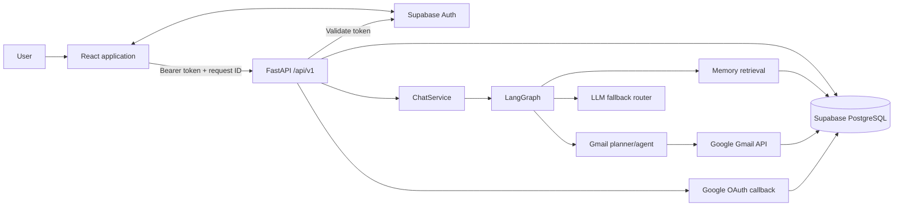
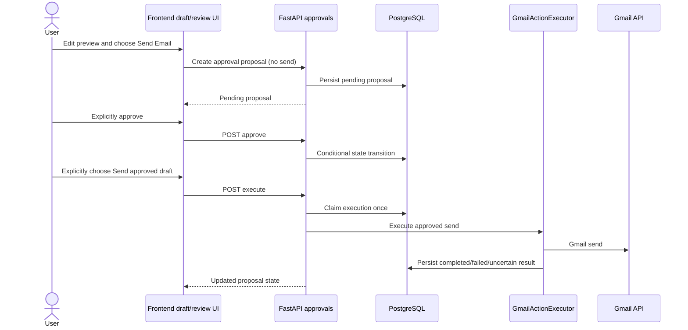

# Personal AI Assistant — Technical Project Handover

This document is a source-checked handover for continuing development in a
new coding assistant session. It describes the repository as inspected on
**2026-11-04**; it is not proof of live production configuration or status.
Read this alongside [README.md](./README.md).

## A. Project Identity and Current Status

- **Project:** Personal AI Assistant.
- **Purpose:** multi-user conversational assistant with persistent memory and
  Gmail integration.
- **Repository:** `Subrata291291/Personal-AI-Assistant`.
- **Workspace inspected:** `C:\Users\ASUS\Desktop\personal_ai_assistant`.
- **Branch:** `main`.
- **Latest commit at inspection:** `33e984a` — `Fix Gmail approval recovery and review UX`
  (`origin/main` pointed to the same commit).
- **Git state before these documentation edits:** a pre-existing, unstaged
  deletion of the root-level `verify_email_parser.py`. Do not restore or stage it
  without the user's direction. This documentation task is intended to change
  only `README.md` and `PROJECT_HANDOVER.md`; it must not commit or push.
- **Application status:** source implements the frontend, API, memory pipeline,
  Gmail integration, and approval-backed Gmail sends described below.
- **Production status:** deployment and Google/Supabase dashboards were not
  inspected. Do not infer that the latest commit is deployed. The production
  frontend origin `https://www.myorbitai.in` appears in backend defaults/CORS,
  but actual live frontend/backend URLs and release state must be confirmed.
- **Repository map:** `backend/app/` contains the API, services, repositories,
  database models, LLM providers, memory, Google integration, and LangGraph
  workflows; `backend/db_migrations/versions/` contains Alembic revisions;
  `backend/tests/` contains pytest coverage. `frontend/src/` contains routes,
  components, contexts, API/service clients, and tests. Root configuration
  includes `alembic.ini`, `.env.example`, and frontend package configuration.
- **Current production diagnostic limitation:** a reported Gmail approval
  “Failed to fetch” could not be tied to a specific production network,
  preflight, API, validation, or database failure because Render logs and
  deployed environment values were not available. The latest code adds request
  ID correlation and idempotent proposal reconciliation; this does not prove
  the production root cause or a live fix.

## B. Technology Stack

| Area | Repository evidence and role |
|---|---|
| Python backend | Python 3.12 is the stated target. Pinned versions: FastAPI 0.162.0, Uvicorn 0.54.0, Pydantic 2.14.2, pydantic-settings 2.16.2, SQLAlchemy 2.1.6, Alembic 1.20.1. |
| Database access | psycopg 3.3.6, Supabase Python 2.33.0, PostgreSQL, JSONB, UUID, arrays, pgvector 0.4.1. |
| Authentication/security | Supabase Auth and Supabase JS; PyJWT 2.15.1 is also present for local JWT helper functions. Google OAuth credentials are encrypted with cryptography 50.0.2. |
| LLM providers | groq 1.7.0, openai 3.42.0, google-genai 2.34.0. OpenRouter is accessed through the provider implementation; there is no separate OpenRouter SDK dependency. |
| Agent orchestration | LangGraph 1.2.19 and langchain-core 1.7.3. The MCP Python SDK 2.3.0 is a dependency; no production MCP server/tools are wired into the current application. |
| Backend utilities | httpx 0.28.1, tenacity 9.1.4, python-dotenv 1.2.4, email-validator 2.3.0. |
| Frontend | React/React DOM `^19.3.1`, Vite `^8.3.5`, React Router `^7.18.5`, TanStack Query `^5.105.2`, Tailwind Vite plugin `^4.3.3`, JavaScript modules. |
| Frontend tests/lint | Vitest `^5.1.0`, jsdom `^30.1.3`, Testing Library, oxlint `^1.89.0`. |
| Hosting intent | Render for backend, Netlify for frontend, Supabase for Auth/PostgreSQL. No Render or Netlify deployment manifest is tracked. |

Python versions are pinned in [backend/requirements.txt](./backend/requirements.txt).
There is no `pyproject.toml` or `.python-version` defining a different Python
range. `frontend/package.json` has no `engines` declaration; Vite 8's installed
package declares Node.js `^20.19.0 || >=22.12.0`. The local environment at
inspection was Python 3.12.10, Node 24.19.0, npm 11.17.0; these are environment
observations, not deployment guarantees.

## C. System Architecture

### High-level request and data flow



### Frontend

- `frontend/src/main.jsx` mounts the app and authentication provider.
- `frontend/src/App.jsx` defines BrowserRouter routes. `/privacy` and `/terms`
  are public. Dashboard pages are grouped under the protected
  `DashboardLayout`.
- `frontend/src/context/AuthContext.jsx` uses Supabase JS for session
  restoration, email/password authentication, email verification, sign-out,
  profile/password updates, and auth state changes.
- `frontend/src/lib/api.js` obtains the current Supabase access token, adds
  `Authorization` and `X-Request-ID`, and calls the required
  `VITE_API_BASE_URL`. Errors are parsed rather than silently discarded.
- `frontend/src/lib/queryClient.js` and TanStack Query manage API-backed state.
- `frontend/src/services/` contains domain API clients; components should use
  these instead of duplicating endpoints.
- `frontend/src/pages/Gmail.jsx` is the mailbox UI and draft-send review flow.
  `EmailDraftCard.jsx` is the chat draft preview. `ActionApprovalCard.jsx`
  supports explicit proposal actions.

### Backend

- `backend/app/main.py` configures FastAPI, CORS, request metrics/correlation,
  and router mounts.
- `backend/app/api/deps.py` validates bearer tokens via Supabase Auth and
  creates a request-scoped Supabase client using the user's token.
- `backend/app/core/` contains settings, auth, encryption, structured logging,
  safe exception logging, and request metrics.
- `backend/app/schemas/` validates requests/responses; `services/` owns
  workflows; `repositories/` owns persistence queries.
- Conversation messages are accessed through the authenticated Supabase
  client in `MessageService`; other app persistence uses SQLAlchemy/repository
  paths over PostgreSQL.
- Google integrations are implemented in `backend/app/integrations/google/`
  and Gmail-specific operations in `backend/app/services/gmail_service.py`.

### Database

PostgreSQL is the system of record for conversations, messages, chat request
leases/idempotency, memories/reviews, settings, Google connections, OAuth
credentials, and OAuth states. The app has SQLAlchemy models and Alembic
migrations; `ChatRequestRepository` and some approval/draft metadata use SQL
against existing tables. The current action-approval record is JSON metadata
on `pa_conversation_messages`; there is no action-approval table or migration.

### Authentication distinction

There are two separate Google-related OAuth uses:

1. **Supabase user sign-in** (Google button on Login/Signup) is initiated with
   Supabase Auth.
2. **Google service connection** (Connectors) is the backend's OAuth flow for
   Google APIs/Gmail. It stores a user-owned Google connection and encrypted
   Google credentials. A Supabase Google sign-in does not by itself establish
   a Gmail API connection.

### Chat request flow

`POST /api/v1/chat` requires an `Idempotency-Key` UUID. `ChatService` claims
the request, loads persisted conversation history, passes user and optional
Gmail-account context into the graph, and persists the resulting messages and
response metadata. The graph's LangGraph checkpointer is an in-memory saver;
durable messages and chat-request operation state are stored separately in
PostgreSQL/Supabase. Do not treat the graph checkpointer as durable history.

### Approval workflow



## D. Implemented Features

“Implemented” below describes code and test coverage, not live deployment
verification. API routes are relative to `/api/v1`.

| Feature | Status | Frontend | Backend / API | Persistence and tests | Limitations |
|---|---|---|---|---|---|
| Authentication and protected app | Implemented | `frontend/src/context/AuthContext.jsx`, `frontend/src/pages/Login.jsx`, `Signup.jsx`, `frontend/src/App.jsx` | `backend/app/api/deps.py`, `backend/app/core/supabase_auth.py`; `/users/me` | Supabase Auth; `frontend/src/App.test.jsx`, `authRedirect.test.js` | Live Supabase redirects/config were not verified. |
| Public legal pages | Implemented | `PrivacyPolicy.jsx`, `TermsOfService.jsx`; `/privacy`, `/terms` | None | `frontend/src/App.test.jsx` and legal pages | Direct production hosting fallback behavior is not verified. |
| Conversation history | Implemented | `Assistant.jsx`, `Conversations.jsx`, `conversationService.js` | `/conversations`, `/conversations/{id}`, `/conversations/{id}/archive`, `/conversations/{conversation_id}/messages` | Supabase-backed conversation/message persistence | No account-wide user deletion endpoint was found. |
| Idempotent chat | Implemented | `Assistant.jsx`, `conversationService.js` | `POST /chat`, `ChatService`, `ChatRequestRepository` | `pa_chat_requests`, request/message IDs and leases; `backend/tests/test_gmail_intent_routing.py` exercises workflow behavior | Requires a valid database target and backend environment. |
| General assistant and LLM fallback | Implemented | `Assistant.jsx`, `AssistantMarkdown.jsx` | `ChatService`, LangGraph, `llm/` | Persisted provider/model/completion metadata | Responses can stop at provider output limits; automatic continuation is not implemented. |
| Persistent memory | Implemented, with operational caveats | `MemoryCenter.jsx`, `Settings.jsx`, `MemorySettingControl.jsx` | `/memories`, `/memory-reviews`, `/users/me/settings`; `MemoryService`, `MemoryPipeline` | `pa_memories`, `pa_memory_reviews`, `pa_user_settings`, pgvector | Dedicated backend pytest coverage is limited; see §F/J. Disabling automatic storage does not necessarily disable retrieval. |
| Google account connection | Implemented | `Connectors.jsx`, `gmailAccountSelection.js` | `/oauth/google/connect`, `/oauth/google/callback`, `/oauth/connections` | `pa_user_connections`, `pa_oauth_states`, `pa_oauth_credentials` | OAuth consent-screen approval, production redirect values, and live token refresh are not verified here. |
| Gmail browse/read/search | Implemented | `Gmail.jsx`, `gmailService.js`, `SenderAvatar.jsx`, `gmailTimestamp.js` | `/gmail/messages`, `/gmail/messages/{message_id}` | Google Gmail API; `backend/tests/test_gmail_received_timestamp.py`, `test_connection_capabilities.py`; frontend `Gmail.test.jsx`, `gmailService.test.js` | Requires a connected account with required grant. |
| Gmail direct mailbox write actions | Implemented as direct authenticated API/UI operations | `Gmail.jsx`, `gmailService.js` | `/gmail/messages/send`, `/{id}/trash`, `/{id}/untrash`, `/{id}/archive`, `/{id}/delete-permanently`, `/{id}/reply`, `/{id}/reply-all`, `/{id}/forward` | Gmail API; `backend/tests/test_gmail_archive.py` and frontend Gmail tests | These endpoints are not all routed through `GmailActionExecutor`; do not claim approval is a universal backend gate. Assistant planning explicitly reports archive/delete unavailable. |
| Chat email preview and Gmail draft save | Implemented | `EmailDraftCard.jsx`, `conversationService.js` | `PATCH /conversations/{conversation_id}/messages/{message_id}/draft`, `POST .../{message_id}/draft/save`, `GET .../{message_id}/draft/save-status` | Draft state/operation metadata stored with conversation messages; `backend/tests/test_gmail_draft_save.py`, frontend `EmailDraftCard.test.jsx`, `conversationService.test.js` | A preview is not a Gmail draft until Save Draft completes. Gmail write operation must be reconciled before retry. |
| Approval-backed Gmail sending | Implemented in code and mocked tests | `EmailDraftCard.jsx`, `ActionApprovalCard.jsx`, `Gmail.jsx`, `actionApprovalService.js` | `/action-approvals` routes; `ActionApprovalService`, `GmailActionExecutor` | Proposal is JSON in message metadata; idempotency uses an existing proposal record. `backend/tests/test_gmail_draft_send_approval.py`, `test_action_approval_idempotency.py`, frontend approval/Gmail tests | Live production failure cause and deployment status are unverified. Executor supports only `gmail.send` and `gmail.send_draft`. |
| Gmail attachment access | Implemented for read/download | `Gmail.jsx`, `gmailService.js` | `GET /gmail/messages/{message_id}/attachments/{attachment_id}` | Gmail API; backend attachment tests; frontend Gmail tests | Draft send review blocks drafts with attachments rather than risking loss of attachment data. |
| Drive, Calendar, Contacts, tasks | Not implemented as data integrations | Connector cards and Assistant UI | Graph has unavailable response routes; action schema has placeholder action names only | No working integration persistence or service tests | Do not call action schema declarations or Google API allowed-host entries implemented product features. |

### API route index

All paths below are mounted below `/api/v1`. Business routes require a valid
authenticated Supabase bearer token. `/health` is public; Google's OAuth
callback is protected by the one-time OAuth state/code flow rather than a
bearer token.

| Method and path | Function |
|---|---|
| `GET /health` | App/database health check. |
| `GET /users/me` | Authenticated profile. |
| `GET`, `PATCH /users/me/settings` | Read/update memory preference. |
| `POST`, `GET /conversations` | Create/list conversations. |
| `GET`, `PATCH`, `DELETE /conversations/{conversation_id}` | Get, rename, delete. |
| `PATCH /conversations/{conversation_id}/archive` | Archive conversation. |
| `POST`, `GET /conversations/{conversation_id}/messages` | Create/list messages. |
| `PATCH /conversations/{conversation_id}/messages/{message_id}/draft` | Update/remove editable email preview. |
| `POST /conversations/{conversation_id}/messages/{message_id}/draft/save` | Save preview to Gmail using UUID `connection_id` and `operation_id` body fields. |
| `GET /conversations/{conversation_id}/messages/{message_id}/draft/save-status` | Reconcile save using connection/operation query fields. |
| `POST /chat` | Idempotent assistant request; requires the `Idempotency-Key` header. |
| `POST /oauth/google/connect`, `GET /oauth/google/callback` | Start Google API OAuth and handle callback. |
| `GET /oauth/connections`, `DELETE /oauth/connections/{connection_id}` | List/disconnect user's connected external accounts. |
| `POST`, `GET /memories`; `GET`, `PATCH`, `DELETE /memories/{memory_id}` | User-scoped memory CRUD. |
| `GET /memory-reviews`, `POST /memory-reviews/{review_id}/accept`, `POST /memory-reviews/{review_id}/reject` | Review ambiguous memory updates. |
| `GET /gmail/messages`, `GET /gmail/messages/{message_id}` | Gmail list/search and full details. |
| `GET /gmail/messages/{message_id}/attachments/{attachment_id}` | Download an attachment from the message. |
| `POST /gmail/messages/send` | Direct Gmail compose/send API. |
| `POST /gmail/messages/{message_id}/trash`, `/untrash`, `/archive`, `/delete-permanently` | Direct mailbox state changes. |
| `POST /gmail/messages/{message_id}/reply`, `/reply-all`, `/forward` | Direct Gmail reply/forward APIs. |
| `POST /action-approvals/gmail-drafts/{message_id}`, `GET /action-approvals/gmail-drafts/approval/{idempotency_key}` | Create/reconcile proposal for sending an existing Gmail draft. |
| `POST /action-approvals`, `GET /action-approvals`, `GET /action-approvals/{proposal_id}` | Create generic proposal, list pending proposals, get/reconcile proposal. |
| `POST /action-approvals/{proposal_id}/approve`, `/reject`, `/execute` | Explicit proposal decision and execution. |

## E. Gmail Integration — Detailed Technical Handover

### OAuth connection and credentials

- Connect entry point: `POST /api/v1/oauth/google/connect`.
- Callback: `GET /api/v1/oauth/google/callback`; it returns a frontend
  connector redirect, not tokens.
- Connection listing/deletion:
  `GET /api/v1/oauth/connections`,
  `DELETE /api/v1/oauth/connections/{connection_id}`.
- `GoogleOAuthClient` builds the Google consent URL using configured scopes,
  `access_type=offline`, configured prompt, `include_granted_scopes=true`, and
  PKCE S256.
- OAuth state is one-time and user-associated; the callback consumes it before
  code exchange. The refresh token is retained on reconnect if Google omits a
  new one. Tokens are never returned to the frontend.
- `OAuthCredentialService` encrypts access and refresh tokens. The implementation
  uses AES-256-GCM in `backend/app/core/security.py`, with a 32-byte
  URL-safe-base64 `ENCRYPTION_KEY`.
- `GoogleAPIClient` checks HTTPS and allowlisted Google API hosts, refreshes
  expired/rejected access tokens, and retries the original request once after
  a 401. Refresh-token updates are persisted by the credential service.
- `GmailService._validate_connection` verifies connection ownership and checks
  the required grant before Gmail operations.

### Current requested Google OAuth scopes

The default is `Settings.GOOGLE_OAUTH_SCOPES` in
`backend/app/core/config.py`; it can be overridden by environment. The
comma-separated default expands to these seven scopes:

| Scope | Used for | Removing it would affect |
|---|---|---|
| `openid` | OpenID Connect identity | Google identity verification during account connection. |
| `email` | User email identity | Reading and associating the Google account email. |
| `profile` | Basic Google profile identity | Profile fields returned by Google identity flow. |
| `https://www.googleapis.com/auth/gmail.readonly` | Listing, searching, reading messages/threads, and attachments | Gmail browse/read/search and Assistant retrieval. |
| `https://www.googleapis.com/auth/gmail.send` | Sending, replies, reply-all, forwards, and send-draft execution | Gmail send operations and approval-backed execution. |
| `https://www.googleapis.com/auth/gmail.modify` | Draft creation and Gmail label/state changes such as archive/trash/restore | Saving/creating drafts and modify operations. |
| `https://mail.google.com/` | Permanent Gmail deletion | Permanent-delete method; this is broader than an ordinary read or send grant. |

The current OAuth default contains **no** Drive, Calendar, or Contacts API
scopes. `ActionType` and `GoogleAPIClient.ALLOWED_HOSTS` include future
integration names/hosts; that does not mean those features are wired.

The OAuth consent-screen configuration and verification status were not
inspected. Gmail permissions include sensitive/restricted scopes; confirm the
current Google Cloud consent-screen classification, verification requirements,
test-user restrictions, and production approval with the Google Cloud project
owner. In particular, re-evaluate whether permanent deletion is required
before requesting the full `mail.google.com` scope.

### Gmail folders, list, search, details, and timestamps

- `GmailService.list_messages` supports `inbox`, `starred`, `important`,
  `sent`, `drafts`, `all`, `spam`, and `trash`.
- API: `GET /api/v1/gmail/messages` takes `connection_id`, `max_results`,
  `page_token`, `query`, and `folder`; the endpoint caps `max_results` at 50.
- List results fetch metadata rather than all message bodies; full details load
  separately using `GET /api/v1/gmail/messages/{message_id}`.
- Search terms are passed to Gmail search. The Assistant also has structured
  read intents for search, opening known messages/threads, unread/important/
  urgent summaries, and finding invitation/meeting information via Gmail.
- Received-time formatting uses Gmail `internalDate` when present through
  `frontend/src/utils/gmailTimestamp.js`.
- Sender avatar rendering and domain/logo handling use
  `frontend/src/components/SenderAvatar.jsx` and
  `frontend/src/utils/senderAvatar.js`.
- Thread summaries bound the number/size of messages passed to the workflow.

### Attachments and email content safety

- Attachment metadata is part of message details. The download route verifies
  that the requested attachment belongs to the message and responds as a
  private, no-store download.
- Gmail HTML is sanitized in `frontend/src/utils/sanitizeEmailHtml.js` and
  rendered through the existing sandboxed iframe path in `Gmail.jsx`.
- Email content and attachments are untrusted data; do not make email body
  text executable or treat it as system instructions.
- The draft-send review currently blocks drafts with attachments because the
  editable send path cannot preserve attachment content.

### Direct Gmail API operations and OAuth mapping

| Operation | Backend service method / API route | Required scope |
|---|---|---|
| List, search, details, thread, attachment read | `list_messages`, `get_message`, `get_thread`, `download_attachment`; GET routes under `/api/v1/gmail/messages` | `gmail.readonly` |
| Send new message | `send_message`; `POST /api/v1/gmail/messages/send` | `gmail.send` |
| Create/save draft | `create_draft`; chat draft-save route `/api/v1/conversations/{conversation_id}/messages/{message_id}/draft/save` | `gmail.modify` |
| Archive | `archive_message`; `POST /api/v1/gmail/messages/{message_id}/archive` | `gmail.modify` |
| Trash/restore | `trash_message` / `restore_message`; `/trash` and `/untrash` routes | `gmail.modify` |
| Permanent delete | `permanently_delete_message`; `/delete-permanently` route | `https://mail.google.com/` |
| Reply/reply-all/forward | `reply_message`, `reply_all_message`, `forward_message`; respective `/reply`, `/reply-all`, `/forward` routes | `gmail.send` |
| Send a saved Gmail draft | `send_draft` through approval executor | `gmail.send` |

The mailbox exposes direct authenticated write routes for send, reply, reply-all,
forward, archive, trash, restore, and permanent delete. They validate the
authenticated user, connection owner, and scope, but do not universally pass
through `GmailActionExecutor`. The Assistant's planner does not perform archive
or delete and explicitly reports them unavailable. Preserve this distinction.

### Chat intent detection and editable email preview

`backend/app/workflows/gmail_agent_nodes.py` uses deterministic checks for
common intents plus a structured LLM planner and strict plan parsing. Compose
requests are distinct from reading/searching existing email. It recognizes
compose, save-draft, send, reply, reply-all, forward, search, and read intents.
An address in a compose request is treated as a recipient, not a Gmail message
ID. The plan extracts recipient fields, subject/purpose, content requirements,
tone, and requested action. Explicit new-compose requests are protected from
stale search context.

Composition creates an editable card in chat. It does not itself call Gmail:

1. **Editable preview:** `EmailDraftCard.jsx` edits To/Cc/Bcc/Subject/Message.
2. **Save Draft:** calls the existing draft-save API. This creates a Gmail
   draft and does not send it.
3. **Send Email:** creates a human-approval proposal. It does not send.
4. **Approve:** an explicit approval transition, still no send.
5. **Send approved draft:** explicit execution request runs the backend
   executor.

Reply, reply-all, and forward compose plans are editable previews based on
validated source message/thread IDs; no source IDs should be invented.

### Gmail draft save and operation-ID reconciliation

- Request model `GmailDraftSaveRequest` in
  `backend/app/schemas/email_draft.py` uses Python `UUID` types with
  `Field(strict=False)` for `connection_id` and `operation_id`. Canonical UUID
  strings from JSON are parsed into UUID objects; malformed UUIDs remain
  invalid. This was the fix for the production 422 caused by strict UUID
  validation requiring pre-built Python UUID instances.
- Route:
  `POST /api/v1/conversations/{conversation_id}/messages/{message_id}/draft/save`.
- Status route:
  `GET /api/v1/conversations/{conversation_id}/messages/{message_id}/draft/save-status`
  with `connection_id` and `operation_id` query parameters.
- Frontend `EmailDraftCard.jsx` preserves a save operation UUID across status
  checks/recovery. The save operation/fingerprint and result are recorded with
  the conversation message metadata; there is no dedicated Gmail-draft
  operation table migration.
- The backend validates ownership/scope and records the save claim before
  calling Gmail. It reconciles by the persisted operation/fingerprint and
  Gmail draft lookup/`X-Personal-AI-Draft-Operation-ID` marker. The lookup
  follows Gmail `nextPageToken` across draft-list pages, rejects repeated page
  tokens, and reports incomplete scans as uncertain instead of assuming no
  draft exists. An uncertain result is not blindly retried.
- Tests include valid UUID string parsing, actual UUID types, malformed UUID
  rejection, no Gmail call before validation, repeated operation behavior,
  multi-page marker lookup, and incomplete-scan handling
  (`backend/tests/test_gmail_draft_save.py`). Real Gmail's preservation and
  visibility of this custom header still need staging verification before
  relying on the marker as production evidence.

### Draft-specific send approval and reconciliation

For an existing Gmail message, the modal determines draft status from the
message's Gmail `DRAFT` label, not subject/content. Drafts show Send; received
messages retain Reply, Reply All, and Forward.

Approval-backed draft-send routes:

- `POST /api/v1/action-approvals/gmail-drafts/{message_id}` with
  `Idempotency-Key`; confirms the message is a Gmail draft and persists an
  immutable `gmail.send_draft` proposal.
- `GET /api/v1/action-approvals/gmail-drafts/approval/{idempotency_key}`
  reconciles proposal creation.
- `POST /api/v1/action-approvals/{proposal_id}/approve`
- `POST /api/v1/action-approvals/{proposal_id}/execute`
- `POST /api/v1/action-approvals/{proposal_id}/reject`
- `GET /api/v1/action-approvals/{proposal_id}` retrieves/reconciles status.

The frontend retains an idempotency key in session storage for the user,
connection, and draft. If storage is unavailable, the UI blocks the operation
instead of submitting without a durable client-side key. Reopening an
attempted review checks status; it does not generate a new key just to check.
Backend proposal IDs are deterministic UUIDv5 values derived from the user and
idempotency key. Repository operations take a PostgreSQL transaction advisory
lock before lookup/insert, without adding schema.

`GmailActionExecutor` accepts only `gmail.send` and `gmail.send_draft`. It
claims execution through conditional proposal state transitions, validates
stored immutable parameters, calls Gmail once, and persists the result. A
timeout/server failure or persistence failure can become `execution_uncertain`.
Draft-send status reconciliation searches for the sent result using the
operation/message information; users must check status rather than blindly
retry. Other action types present in the Pydantic schema/service scope map are
not executable through this executor.

The approval review UI uses a viewport-bounded modal, a primary modal content
scroller, a visible footer, bounded message textarea, and body-scroll lock.
The frontend adds request IDs to API calls and formats FastAPI validation
arrays without echoing raw validation `input`. The code's request/response
flow is tested with mocks; actual production Render logs/API configuration are
still needed to explain the earlier “Failed to fetch.”

## F. Memory System

### Implemented types and storage

`pa_memories` supports four persisted types: `long_term`, `episodic`,
`semantic`, and `procedural`. There is no separate persisted `short_term`
memory table/type. Recent conversation history and LangGraph's in-memory
checkpointer provide short-lived conversational context.

The classifier prompt defines these types as:

- `long_term`: stable personal preferences, interests, goals, and
  characteristics.
- `episodic`: specific events, experiences, activities, and decisions.
- `semantic`: user-specific facts, professional information, ongoing
  projects, technical stacks, and meaningful relationships.
- `procedural`: recurring workflows, habits, and instructions.

These are classifier categories, not separate database schemas or retrieval
engines.

Memory records include user ID, type, content, a 768-dimensional pgvector
embedding, importance, confidence, JSONB metadata, optional source
conversation, expiration, and timestamps. The embedding implementation uses
Google Gemini model `gemini-embedding-2`; generation requires
`GEMINI_API_KEY`, independently of which provider generated a chat response.

### Retrieval and automatic processing

- `memory_retrieval_node` retrieves up to five user-owned memories at a
  similarity threshold of 0.70 for general/daily-planning chat.
- Retrieved records are explicitly framed as untrusted contextual data in the
  LLM prompt.
- Retrieval failures are logged and chat continues without memory context.
- Automatic memory storage checks the user's `memory_enabled` preference.
  Retrieval is a separate path and should not be assumed disabled by that
  preference.
- `MemoryPipeline` classifies extracted content, applies memory policy,
  detects duplicates, resolves conflicts, stores/updates eligible records,
  and creates review records for ambiguous cases.
- Review decisions are available through memory-review endpoints.

### API, UI, and source files

- API: `POST/GET /api/v1/memories`, `GET/PATCH/DELETE /api/v1/memories/{memory_id}`.
- Reviews: `GET /api/v1/memory-reviews`,
  `POST /api/v1/memory-reviews/{review_id}/accept`,
  `POST /api/v1/memory-reviews/{review_id}/reject`.
- Preference: `GET/PATCH /api/v1/users/me/settings`.
- Core files: `backend/app/memory/memory_pipeline.py`,
  `embedding_service.py`, `classifier/`, `deduplication/`,
  `backend/app/services/memory_service.py`, `memory_review_service.py`,
  and `backend/app/repositories/memory_repository.py`.
- UI: `frontend/src/pages/MemoryCenter.jsx`, `Settings.jsx`, and
  `MemorySettingControl.jsx`.
- Tests: frontend `MemorySettings.test.jsx`; the current backend pytest
  directory has no dedicated memory test module. Add focused tests when
  changing memory behavior.

## G. LLM and Agent Architecture

### Providers and fallback

Default provider priority is `groq,openrouter,gemini,openai`, configurable with
`LLM_PROVIDER_PRIORITY`. A provider is skipped unless both its API key and
model are configured. `ProviderRegistry` constructs adapters for Groq,
OpenRouter, Gemini, and OpenAI.

`FallbackManager` advances to the next configured provider for classified
transient network/timeout, HTTP 408/429, and HTTP 5xx failures. Non-transient
HTTP/provider failures are raised instead of silently switching providers.
Per-provider timeout and output limits are configurable via the environment.
Provider completion metadata (including finish reason/token use where
available) is persisted for assistant messages. An output-limit result is not
automatically continued; UI can mark the response as incomplete.

### Graph and intent routing

`backend/app/workflows/chat_graph.py` builds a LangGraph:

1. `intent_router` (implemented by `gmail_intent_router_node`) selects general,
   daily-planning, Gmail, or unavailable integration routes.
2. General/daily-planning goes through `memory_retrieval` then `llm`.
3. Gmail requests go through `gmail_agent`.
4. Drive, Calendar, Contacts, and tasks go to an explicit unavailable node.

Gmail planning supports separate intent labels including `gmail_search`,
`gmail_read`, `gmail_compose`, `gmail_save_draft`, `gmail_send`,
`gmail_reply`, `gmail_reply_all`, `gmail_forward`, `gmail_archive`,
`gmail_delete`, plus summary/search legacy intent names. `gmail_archive` and
`gmail_delete` are classified only to explain that the Assistant will not
perform them. Sending is always represented by an editable draft/proposal
workflow; the intent planner must never create or execute an approval by
itself.

Planner output is parsed into Pydantic schemas. Deterministic intent routing
handles common compose and read requests; ambiguous read sources may request
clarification. Available Gmail source IDs and draft context are bounded and
validated. Do not interpret an address in a compose request as a message ID.

`ChatService` calls `chat_graph.invoke` synchronously. Some Gmail operations
are bridged from sync workflow code to async service calls; avoid a broad async
conversion without tracing runtime/worker behavior and tests.

## H. Database and Authentication

### Authentication and ownership

- The frontend stores/persists Supabase Auth sessions through Supabase JS.
- Backend `get_current_user` calls Supabase Auth's `/auth/v1/user` endpoint to
  validate the bearer token; authenticated user ID is used for ownership
  filters.
- Authenticated Supabase clients use the user's bearer token for message and
  conversation operations. SQLAlchemy/database code also performs explicit
  ownership checks.
- Application migrations enable and force RLS on user-owned tables. Explicit
  `auth.uid()` policies are present for conversations, messages, settings,
  connections, memories, and chat requests. Migrations also enable/force RLS
  for OAuth credentials, OAuth states, and memory reviews, but no explicit
  `CREATE POLICY` statement for those three tables was found in the migration
  files inspected. Server access may depend on the configured database role;
  verify the actual role and migration state before claiming production access
  or isolation behavior. Ordinary roles without a policy or RLS bypass do not
  gain row access merely because a table exists.
- The database URL builder requires a configured URL and adds
  `sslmode=require` if none is present.

### Models/tables represented by migrations

- `auth.users` is owned by Supabase Auth and is not created by this project's
  migrations.
- App tables include `pa_conversations`, `pa_conversation_messages`,
  `pa_chat_requests`, `pa_user_settings`, `pa_user_connections`,
  `pa_oauth_credentials`, `pa_oauth_states`, `pa_memories`, and
  `pa_memory_reviews`.
- Schema relationships include Supabase `auth.users` ownership for conversations,
  settings, connections, OAuth states, memories, reviews, and chat requests;
  messages belong to conversations; memories optionally reference a source
  conversation; reviews optionally reference an existing memory; credentials
  reference a connection through the composite `(connection_id, user_id)`
  constraint; and chat requests reference their conversation and optional
  user/assistant messages. The declared delete actions vary by relation
  (`CASCADE`, `SET NULL`); consult the model/migration before changing cleanup
  behavior.
- Chat request migrations add idempotency, execution/lease, and
  message-reference fields.
- Approval proposals and Gmail draft save operation/result metadata are
  stored with conversation-message JSON metadata; no separate approval table
  or Gmail operation table is present in the migration history.
- SQLAlchemy definitions are in `backend/app/db/models/`; migration files are
  in `backend/db_migrations/versions/`.
- The checked-in migration inventory (revision ID and file purpose) is:
  `019b1ee3f7e0` conversation messages; `6ee5bbe8410e` conversations;
  `023364c627d0` OAuth states; `a73faa34ca23` user connections;
  `895f8d00188b` OAuth credentials; `90ed5bf7013b` persistent memories;
  `8a97f7715f18` user settings; `d8b6b04f83c1` chat requests;
  `6f37d9a42afe` chat request IDs on messages; `4a91c2e7b630` chat request
  lease fields; `25e053b2e67c` conversation UUID server default;
  `a45c51b4a676` chat request execution-safety fields; and
  `821cd57b946d` memory reviews. See each version file for exact operations
  and `down_revision`; this inventory is not a statement of the live database
  migration state.
- A read-only local `alembic heads` check returned one head,
  `821cd57b946d`. This is not evidence that any live database has applied it.

### Google connection credentials

Connection and credential rows are user-owned. Access/refresh token values
are encrypted with AES-256-GCM before database persistence and decrypted only
when credentials are used. Scope names and token expiry are stored as
metadata; tokens are not returned by the OAuth callback. `ENCRYPTION_KEY`
rotation must account for already encrypted values or existing credentials
will not decrypt.

No account-wide user-deletion API was found. Conversation deletion, memory
deletion, and Google connection disconnection are separate paths; do not
promise they delete all associated Google/Supabase data or revoke Google-side
consent without verifying the exact service behavior.

## I. Deployment and Production Configuration

### What source establishes

- Render, Netlify, and Supabase are project deployment/service targets in
  project notes and environment conventions.
- No `render.yaml`, `netlify.toml`, `Procfile`, Dockerfile, or tracked CI
  workflow was found in the repository.
- Backend CORS defaults include `http://localhost:5173` and
  `https://www.myorbitai.in`; the OAuth callback's frontend redirect uses
  `FRONTEND_URL` with a production fallback to `https://www.myorbitai.in`
  when the configured URL is localhost.
- Google redirect URI must target
  `{API_V1_PREFIX}/oauth/google/callback`; production requires HTTPS.
- Frontend API origin comes from `VITE_API_BASE_URL`; frontend Supabase
  settings come from `VITE_SUPABASE_URL` and `VITE_SUPABASE_ANON_KEY`.

### What must be confirmed in dashboards

The deployed backend URL, deployed frontend URL, current Supabase project URL,
Render start/health-check settings, Netlify build/publish/SPA redirect
settings, deployed Vite environment, Google OAuth client callback/authorized
origins, OAuth consent-screen verification, and live Alembic revision. Do not
invent these values. The configured CORS origin in source is not proof the
domain is currently live.

### Environment variables

Root `.env.example` includes these groups (names only; never copy real values
into documentation):

| Group | Variables |
|---|---|
| App | `APP_NAME`, `APP_ENV`, `DEBUG`, `API_V1_PREFIX` |
| Security | `JWT_SECRET_KEY`, `ENCRYPTION_KEY` |
| Supabase/PostgreSQL | `SUPABASE_URL`, `SUPABASE_ANON_KEY`, `SUPABASE_SERVICE_ROLE_KEY`, `DATABASE_URL` |
| LLM provider selection | `LLM_PROVIDER_PRIORITY` |
| Groq | `GROQ_API_KEY`, `GROQ_MODEL`, `GROQ_TIMEOUT_SECONDS`, `GROQ_MAX_OUTPUT_TOKENS` |
| OpenRouter | `OPENROUTER_API_KEY`, `OPENROUTER_MODEL`, `OPENROUTER_TIMEOUT_SECONDS`, `OPENROUTER_MAX_OUTPUT_TOKENS` |
| Gemini | `GEMINI_API_KEY`, `GEMINI_MODEL`, `GEMINI_TIMEOUT_SECONDS`, `GEMINI_MAX_OUTPUT_TOKENS` |
| OpenAI | `OPENAI_API_KEY`, `OPENAI_MODEL`, `OPENAI_TIMEOUT_SECONDS`, `OPENAI_MAX_OUTPUT_TOKENS` |
| Google OAuth | `GOOGLE_CLIENT_ID`, `GOOGLE_CLIENT_SECRET`, `GOOGLE_REDIRECT_URI` |
| URLs/CORS | `FRONTEND_URL`, `CORS_ALLOWED_ORIGINS`, `BACKEND_URL` |

Backend settings also provide `GOOGLE_OAUTH_SCOPES` (default documented in
§E), `GOOGLE_OAUTH_ACCESS_TYPE`, and `GOOGLE_OAUTH_PROMPT`; those are not
listed in `.env.example`. The frontend additionally requires
`VITE_API_BASE_URL`, `VITE_SUPABASE_URL`, and `VITE_SUPABASE_ANON_KEY`, also
not listed in the root sample. The browser bundle must never receive the
Supabase service-role key, OAuth client secret, database password, or LLM
provider keys.

## J. Testing and Verification

### Commands

From `backend/`:

```powershell
..\.venv\Scripts\python.exe -m pytest -q
```

From `frontend/`:

```powershell
npm test
npm run build
npm run lint
```

Frontend scripts are defined in `frontend/package.json`; Vitest/jsdom setup is
in `frontend/vite.config.js` and `frontend/src/test/setup.js`.

### Important existing tests

Backend pytest modules include:

- `test_gmail_draft_save.py`
- `test_gmail_draft_send_approval.py`
- `test_action_approval_idempotency.py`
- `test_gmail_intent_routing.py`
- `test_gmail_archive.py`
- `test_gmail_received_timestamp.py`
- `test_connection_capabilities.py`
- `test_google_oauth_redirects.py`
- `test_cors.py`

Frontend regression tests include `Gmail.test.jsx`, `EmailDraftCard.test.jsx`,
`ActionApprovalCard.test.jsx`, `actionApprovalService.test.js`, API/error
formatting tests, authentication redirect tests, connector tests, memory
setting tests, and timestamp/avatar tests.

### Last recorded verification before this docs-only task

- Backend full pytest suite: **57 passed**.
- Frontend Vitest suite: **78 passed** across 14 files.
- Frontend production build: succeeded; Vite warned the main minified JS chunk
  was about 894 kB, above the 500 kB advisory threshold.
- Frontend oxlint: completed with warnings, including existing effect/hook
  warnings in `Gmail.jsx`, `Assistant.jsx`, `Connectors.jsx`,
  `MemoryCenter.jsx`, `Conversations.jsx`, and `AuthContext.jsx`.
- `git diff --check`: passed for the implementation changes.

These are local automated checks, not a live production deployment test.
This documentation-only update should run `git diff --check` and verify paths;
it need not rerun application suites unless documentation tooling is added.

### Manual verification still required

Use test accounts and no real Gmail writes: verify configured OAuth redirects,
frontend-to-backend API origin, CORS preflight/request IDs, safe Gmail browse,
approval creation/reconciliation, conversation restoration, and production
logs with a sanitized request ID. Visual review on mobile/dark/light themes is
also not established by unit tests.

## K. Known Issues and Limitations

| Priority | Issue | Current status | Relevant files | Next diagnostic step |
|---|---|---|---|---|
| High | Reported approval request “Failed to fetch” | Production root cause remains **unconfirmed**; latest code includes request correlation, idempotency, and status reconciliation. | `frontend/src/lib/api.js`, `frontend/src/pages/Gmail.jsx`, `backend/app/api/v1/endpoints/action_approvals.py`, `backend/app/main.py` | Obtain sanitized Render logs by timestamp/request ID; verify OPTIONS and POST arrival/status and deployed `VITE_API_BASE_URL` without disclosing values. |
| High | Broad Gmail OAuth permissions | Confirmed source configuration requests `mail.google.com` in addition to Gmail read/send/modify and profile scopes. Google console review status is unknown. | `backend/app/core/config.py`, `backend/app/services/gmail_service.py`, `backend/app/integrations/google/oauth_client.py` | Confirm consent-screen classification/verification and evaluate whether permanent-delete behavior is necessary before changing scopes. |
| Medium | Live deployment settings are not in repository | Confirmed absence of Render/Netlify manifests; actual dashboard values unavailable. | `.env.example`, `backend/app/core/config.py`, `frontend/src/lib/api.js`, `frontend/src/lib/supabase.js` | Verify deploy commands, SPA fallback, URLs, env names, redirects, CORS, and deployed commit in dashboards. |
| Medium | Some Gmail writes do not go through approval executor | Confirmed direct mailbox API routes exist; Assistant archive/delete are unavailable, but several mailbox UI writes call Gmail endpoints directly. | `backend/app/api/v1/endpoints/gmail.py`, `frontend/src/pages/Gmail.jsx`, `frontend/src/services/gmailService.js` | Confirm intended product/safety policy with the user before altering write gating. |
| Medium | Gmail draft send with attachments | Confirmed review UI blocks drafts with attachments to avoid losing them. | `frontend/src/pages/Gmail.jsx`, `backend/app/services/gmail_service.py` | Design attachment-preserving review/send semantics before claiming support. |
| Medium | Draft-save marker behavior on real Gmail | Mock tests exercise marker lookup and multi-page reconciliation; real Gmail preservation/visibility has not been verified. | `backend/app/integrations/google/message_builder.py`, `backend/app/services/gmail_service.py`, `backend/tests/test_gmail_draft_save.py` | Verify on a dedicated staging account using non-sensitive draft content and reconcile by the same operation ID. |
| Medium | Output length limits | Provider metadata can indicate output-limited completion; automatic continuation is not implemented. | `backend/app/llm/`, `backend/app/workflows/chat_nodes.py`, `frontend/src/components/AssistantMarkdown.jsx` | Reproduce using mock provider responses and add continuation only with idempotent/persistence design. |
| Low | Bundle size and lint warnings | Confirmed local build warning for >500 kB main chunk and oxlint warnings. | `frontend/src/pages/Gmail.jsx`, other files named in §J, `frontend/vite.config.js` | Establish a baseline; address only when the related feature is changed or an explicit optimization task is requested. |
| Planned | Google Drive, Calendar, Contacts, tasks/reminders | Not implemented as integrations; graph routes return an unavailable response. | `backend/app/workflows/chat_graph.py`, `chat_nodes.py`, connector UI | Treat as roadmap work, not a functioning production feature. |

## L. Pending Development Roadmap

Statuses reflect source/repository evidence, not user-approved priority.

| Area | Item | Status |
|---|---|---|
| Critical fixes | Diagnose the production approval “Failed to fetch” using sanitized Render request logs and deployed API-origin configuration. | Requires production verification |
| Critical fixes | Validate the deployed database's migration revision and RLS/connection role before relying on migration state. | Requires production verification |
| Gmail improvements | Reassess Google OAuth scopes and approval/verification requirements; particularly the broad full-mail scope. | Requires production verification |
| Gmail improvements | Define and implement attachment-preserving draft review/send if desired. | Pending |
| Gmail improvements | Confirm whether all direct mailbox write actions are intended to remain outside the human-approval executor. | Requires user decision |
| Google Calendar integration | Implement OAuth scopes, services, endpoints, UI, and safe approval rules only after explicit scope/design approval. | Pending |
| Google Drive integration | Implement actual Drive service, authorization, endpoints, UI, and approvals; current intent routes are placeholders. | Pending |
| Google Contacts integration | Implement actual Contacts API workflow and authorization; current route is a placeholder. | Pending |
| Memory improvements | Add focused backend memory CRUD, isolation, retrieval, pipeline, and review tests. | Pending |
| Agent intelligence improvements | Add targeted routing tests when adding intents; preserve strict schema and source-ID boundaries. | Pending |
| UI/UX improvements | Evaluate chunk splitting and clear current lint warnings without unrelated changes. | Pending |
| Security and reliability | Review deployed DB role/RLS and data deletion/disconnection semantics. | Requires production verification |
| Testing and deployment | Authenticated safe browser smoke test and production checks with request-ID correlation. | Requires production verification |
| Current Gmail approval recovery work | Durable idempotent proposal creation/status lookup, user approval, explicit send execution, readable errors, request IDs, and responsive review modal. | Completed in source; production verification required |

## M. Exact Next Steps

1. **Diagnose the approval failure in production.**
   - **Do:** ask for a timestamp/request ID and inspect sanitized Render logs,
     OPTIONS/POST status, backend route, and database outcome. Verify
     `VITE_API_BASE_URL` points to the intended API origin without printing
     secrets.
   - **Why:** the code now reconciles proposal creation, but cannot prove which
     production layer caused the original fetch failure.
   - **Inspect:** `frontend/src/lib/api.js`,
     `frontend/src/services/actionApprovalService.js`,
     `frontend/src/pages/Gmail.jsx`,
     `backend/app/api/v1/endpoints/action_approvals.py`,
     `backend/app/main.py`.
   - **Dependencies:** dashboard/log access and sanitized request metadata.
   - **Expected result/tests:** identify whether request did not leave browser,
     failed CORS/network, reached FastAPI, or failed persistence; then add a
     regression only for the confirmed case.

2. **Verify deployed OAuth and deployment configuration read-only.**
   - **Do:** compare deployed frontend/backend origins, CORS, OAuth callback,
     consent-screen status, environment variable names, and deployed commit
     with repository defaults.
   - **Why:** source defaults do not prove dashboard values or deployment.
   - **Inspect:** `.env.example`, `backend/app/core/config.py`,
     `backend/app/integrations/google/oauth_client.py`,
     `frontend/src/lib/api.js`, `frontend/src/lib/supabase.js`.
   - **Dependencies:** access to Render, Netlify, Supabase, and Google Cloud
     dashboards.
   - **Expected result/tests:** a sanitized configuration checklist; no secrets
     copied into chat or docs.

3. **Decide Gmail scope and write-approval policy with the owner.**
   - **Do:** verify which live Gmail product features are required and whether
     permanent delete/full-mail access is still needed. Decide whether direct
     mailbox actions should remain available or be gated.
   - **Why:** this affects OAuth review and user-visible safety; it is not a
     safe unilateral code change.
   - **Inspect:** `backend/app/core/config.py`,
     `backend/app/services/gmail_service.py`,
     `backend/app/services/action_approval_service.py`,
     `backend/app/api/v1/endpoints/gmail.py`.
   - **Dependencies:** user decision and Google Cloud verification status.
   - **Expected result/tests:** agreed scope/approval design; no scope change or
     live Gmail mutation without explicit authorization.

4. **Add backend memory regression coverage.**
   - **Do:** test CRUD ownership, vector query filters, auto-storage preference,
     conflict review and accept/reject flows with isolated mocks/fixtures.
   - **Why:** the memory subsystem is implemented but lacks a dedicated backend
     pytest module in the current suite.
   - **Inspect:** §F source files and corresponding models/repositories.
   - **Dependencies:** existing project fixtures and safe database mocking.
   - **Expected result/tests:** focused pytest module with no live Supabase
     credentials.

5. **Perform safe UI smoke checks; do not send or modify real email.**
   - **Do:** review public routes, Gmail modal responsiveness/theme behavior,
     sanitized email rendering, and approval status/uncertain recovery with
     mocked APIs.
   - **Why:** automated tests do not establish production browser behavior.
   - **Inspect:** `frontend/src/App.jsx`, `Gmail.jsx`,
     `sanitizeEmailHtml.js`, `Gmail.test.jsx`, approval tests.
   - **Dependencies:** local frontend variables and test account only for
     read-only browsing; do not approve/execute a real send.
   - **Expected result/tests:** documented local/browser observations and
     focused test results.

6. **Start one future Google integration only after scope approval.**
   - **Do:** choose Drive, Calendar, or Contacts; specify required read/write
     behavior, consent scopes, UI, API, and approval rules before
     implementation.
   - **Why:** graph route/action schema placeholders are not implementations.
   - **Inspect:** `backend/app/integrations/connectors/`,
     `backend/app/workflows/chat_graph.py`,
     `backend/app/schemas/action_approval.py`.
   - **Dependencies:** user-approved scope and provider verification.
   - **Expected result/tests:** complete feature slice, not a connector card or
     schema-only declaration.

## N. Instructions for the Next AI Coding Assistant

1. Read `README.md` first.
2. Read this entire `PROJECT_HANDOVER.md` before changing code.
3. Inspect `git status --short` before modifications. Preserve every user
   change, including the currently observed deletion of the root-level
   `verify_email_parser.py`; do not reset, clean, or restore it
   without instruction.
4. Verify current source and deployment evidence; documentation and prior chat
   are not proof that runtime behavior is unchanged.
5. Preserve existing architecture unless evidence justifies a change.
6. Do not overwrite existing files unnecessarily; use focused edits.
7. Do not introduce duplicate services, endpoints, or business logic.
8. Do not remove existing functionality without explicit approval.
9. Do not change production configuration or deploy automatically.
10. Never expose or request secret credentials. Do not read real `.env` values
    for documentation or diagnostics. Redact logs and identifiers as needed.
11. Run relevant backend/frontend tests after each implementation and report
    exactly what was run.
12. Report exact changed files and test results; distinguish mocks from live
    provider, OAuth, Gmail, database, and browser validation.
13. Explain architectural decisions and trade-offs, especially for Gmail
    scopes, direct write endpoints, approval, and idempotency.
14. Work incrementally. Ask before major scope, destructive behavior,
    migration, OAuth, approval-policy, deployment, commit, or push changes.
15. Never perform Gmail writes during routine testing. Never blindly retry an
    uncertain draft-save or send operation; query/reconcile its existing
    operation/proposal ID.
16. Add/update tests following the repository's existing pytest and Vitest
    patterns. Older handover text said automated test files were prohibited;
    that is stale—the repository has maintained automated regression suites.
