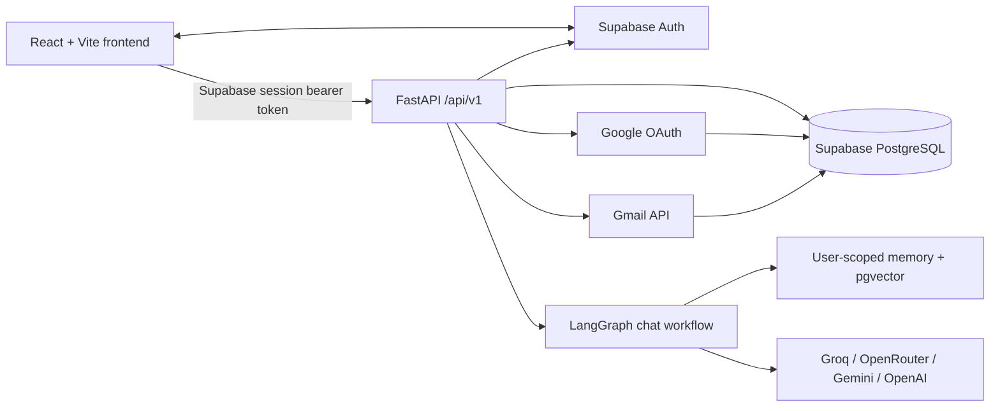

# Personal AI Assistant

Personal AI Assistant is a multi-user web application for conversational
assistance, persistent user-controlled memory, and Gmail workflows. Its
backend is a FastAPI service; the React application authenticates users with
Supabase and calls the backend with the current Supabase access token.

For current implementation details, known limitations, and safe next steps,
read [PROJECT_HANDOVER.md](./PROJECT_HANDOVER.md).

## Project goals and capabilities

- Provide authenticated chat with persisted conversations and request
  idempotency.
- Personalize general responses with user-scoped memories and semantic
  retrieval.
- Connect a user's Google account for Gmail browsing, search, draft
  management, and selected message actions.
- Keep email composition, Gmail draft saving, approval proposals, and actual
  sending as separate operations.
- Support pluggable language-model providers with transient-failure fallback.

Implemented Google API access is Gmail-focused. Google Drive, Calendar,
Contacts, tasks, and reminders are not connected integrations; Assistant
requests for those services receive an unavailable response.

## Technology stack

| Area | Technologies in this repository |
|---|---|
| Frontend | React 19, JavaScript, Vite 8, React Router 7, TanStack Query, Tailwind CSS 4 |
| Backend | Python 3.12 target, FastAPI, Pydantic 2, SQLAlchemy 2, Alembic |
| Database | Supabase-hosted PostgreSQL, PostgreSQL JSONB/UUID/arrays, pgvector |
| Authentication | Supabase Auth; Supabase JavaScript client and backend bearer-token verification |
| AI/LLM | Groq, OpenRouter, Google Gemini, OpenAI; Gemini embeddings |
| Agent orchestration | LangGraph; the Python MCP SDK is a dependency, but no production MCP tool server is wired in the current app |
| External integrations | Google OAuth and Gmail API |
| Deployment | Render, Netlify, and Supabase are the intended hosting/services; deployment dashboards and live configuration are not verified from this repository |

Backend dependencies and versions are pinned in
[backend/requirements.txt](./backend/requirements.txt). Frontend dependency
ranges and scripts are in [frontend/package.json](./frontend/package.json);
the resolved dependency tree is recorded in `frontend/package-lock.json`.
Vite 8 declares Node.js `^20.19.0 || >=22.12.0`. The repository does not set a
separate Node `engines` field.

## Architecture



The browser uses TanStack Query for API-backed state. Backend bearer
authentication is validated against Supabase Auth. Conversation messages use
the authenticated Supabase client; application records, connector credentials,
settings, memory, and chat request tracking also use PostgreSQL through
SQLAlchemy/repositories. Google tokens are encrypted before persistence.

For chat, the backend validates the user and conversation, claims the
idempotent chat request, loads history, invokes the LangGraph router, and
persists the resulting messages and metadata. General chat passes through
memory retrieval and an LLM; Gmail requests go to a Gmail-specific planner and
workflow.

## Major implemented features

- Supabase email/password authentication, email verification, password reset,
  Google sign-in through Supabase, and protected dashboard routes.
- Public `/privacy` and `/terms` pages.
- Conversations, message history, archival, and deletion.
- User settings for automatic memory storage.
- Persistent memory records of type `long_term`, `episodic`, `semantic`, and
  `procedural`, with embeddings and review of ambiguous updates.
- Gmail account connection/disconnection, mailbox folders, paginated listing,
  Gmail search, message details, attachment downloads, and message actions.
- Chat-generated editable email previews, Gmail draft saving, and a distinct
  send-approval workflow.
- Email HTML sanitization and sandboxed display; Markdown/GFM assistant
  responses.
- Request-ID correlation and timing instrumentation.

Gmail reply, reply-all, forward, compose/send, archive, trash, restore, and
permanent-delete API methods exist. Not all of those operations are available
through the Assistant. In particular, the Assistant currently reports archive
and delete as unavailable. Some mailbox UI actions call direct authenticated
Gmail endpoints rather than the action-approval executor; see the handover
before changing write behavior.

## Repository layout

```text
.
├── backend/
│   ├── app/
│   │   ├── api/                 FastAPI dependencies and versioned endpoints
│   │   ├── core/                Settings, auth, logging, metrics, security
│   │   ├── db/                  SQLAlchemy models and session setup
│   │   ├── integrations/        Supabase and Google API/OAuth clients
│   │   ├── llm/                 Providers, registry, fallback, schemas
│   │   ├── memory/              Embeddings, retrieval, classification, reviews
│   │   ├── repositories/        Database persistence/query logic
│   │   ├── schemas/             Pydantic request/response validation
│   │   ├── services/            Business workflows and integrations
│   │   └── workflows/           LangGraph and Gmail tools/nodes
│   ├── db_migrations/versions/  Alembic migration history
│   ├── tests/                   Backend pytest regression tests
│   ├── scripts/                 Project scripts
│   └── requirements.txt         Pinned Python dependencies
├── frontend/
│   ├── src/components/          Reusable UI, email, and approval components
│   ├── src/context/             Authentication context
│   ├── src/lib/                 API, Supabase, errors, query client
│   ├── src/pages/               Application routes and page tests
│   ├── src/services/            Frontend API service modules
│   ├── src/utils/               Gmail formatting and HTML safety utilities
│   ├── package.json             Frontend scripts and dependency ranges
│   └── vite.config.js           Vite and Vitest configuration
├── .env.example                 Backend environment-variable names/placeholders
├── README.md
└── PROJECT_HANDOVER.md          Detailed active-development handover
```

## Local development (Windows PowerShell)

### Requirements

- Python 3.12 is the project's stated Python target.
- Node.js compatible with Vite 8 (`^20.19.0 || >=22.12.0`) and npm.
- A Supabase project with Auth and PostgreSQL configured.
- A PostgreSQL connection suitable for this application. The backend requires
  `DATABASE_URL` and sets `sslmode=require` if no SSL mode is present.
- LLM credentials and model names for AI features. Google OAuth credentials
  are additionally required for Gmail.

### 1. Create and configure the backend environment

Run from the repository root:

```powershell
py -3.12 -m venv .venv
.\.venv\Scripts\Activate.ps1
python -m pip install --upgrade pip
python -m pip install -r backend\requirements.txt
if (-not (Test-Path .env)) { Copy-Item .env.example .env }
```

Edit the local root `.env` using values from your own service dashboards.
`backend/app/core/config.py` loads this file. Do not copy real credentials
into source control, documentation, logs, or chat. `GOOGLE_OAUTH_SCOPES` has
a code default but is not listed in `.env.example`.

### 2. Configure the frontend environment

The frontend reads Vite-prefixed variables from `frontend/.env`; this file is
not supplied as a tracked example. Create it locally with the required names:

```dotenv
VITE_API_BASE_URL=http://127.0.0.1:8000
VITE_SUPABASE_URL=
VITE_SUPABASE_ANON_KEY=
```

`VITE_API_BASE_URL` is the backend origin only; frontend API services append
`/api/v1/...`. `VITE_SUPABASE_URL` and `VITE_SUPABASE_ANON_KEY` are required
by `frontend/src/lib/supabase.js`. Use the intended project values locally;
do not place service-role keys or other server secrets in the frontend.

### 3. Apply migrations deliberately

Review the configured database target before running a migration command.
Alembic migrations change the target database; do not run them against a
production database as part of local setup.

```powershell
Set-Location backend
..\.venv\Scripts\python.exe -m alembic heads
..\.venv\Scripts\python.exe -m alembic upgrade head
```

The Alembic configuration is `backend/alembic.ini`; its script directory is
`backend/db_migrations`. Migration files do not establish which revision is
applied to any live database. Check the target and current revision before
upgrading it.

### 4. Start backend and frontend

Backend terminal, from `backend/`:

```powershell
..\.venv\Scripts\python.exe -m uvicorn app.main:app --reload --host 127.0.0.1 --port 8000
```

Frontend terminal, from `frontend/`:

```powershell
npm ci
npm run dev
```

The Vite development server normally reports its local URL (configured
development origin in the backend defaults to `http://localhost:5173`).
FastAPI's OpenAPI interface is available at `http://127.0.0.1:8000/docs` when
the backend is running.

## Environment configuration

The root [.env.example](./.env.example) lists backend variable names and
non-secret placeholders. Major groups are:

- Application/API: `APP_NAME`, `APP_ENV`, `DEBUG`, `API_V1_PREFIX`.
- Security: `JWT_SECRET_KEY`, `ENCRYPTION_KEY`.
- Supabase/database: `SUPABASE_URL`, `SUPABASE_ANON_KEY`,
  `SUPABASE_SERVICE_ROLE_KEY`, `DATABASE_URL`.
- LLM providers: `LLM_PROVIDER_PRIORITY`, and each provider's API key, model,
  timeout, and output-token limit (`GROQ_*`, `OPENROUTER_*`, `GEMINI_*`,
  `OPENAI_*`).
- Google OAuth: `GOOGLE_CLIENT_ID`, `GOOGLE_CLIENT_SECRET`,
  `GOOGLE_REDIRECT_URI`.
- Origins: `FRONTEND_URL`, `CORS_ALLOWED_ORIGINS`, `BACKEND_URL`.

The application settings class also defines `GOOGLE_OAUTH_SCOPES`,
`GOOGLE_OAUTH_ACCESS_TYPE`, and `GOOGLE_OAUTH_PROMPT`. Read
[PROJECT_HANDOVER.md](./PROJECT_HANDOVER.md) for defaults, exact OAuth scope
contents, and production values that still need confirmation. Do not disclose
the contents of a real `.env`.

## API overview

All backend endpoints are mounted under `/api/v1`. Main route groups:

- `/health`
- `/users`
- `/conversations` and `/conversations/{conversation_id}/messages`
- `/chat`
- `/oauth`
- `/memories` and `/memory-reviews`
- `/gmail`
- `/action-approvals`

The detailed route list and the distinction between direct Gmail API writes
and approval-backed sends are in [PROJECT_HANDOVER.md](./PROJECT_HANDOVER.md).

## Testing, build, and lint

Run backend tests from `backend/`:

```powershell
..\.venv\Scripts\python.exe -m pytest -q
```

Run frontend checks from `frontend/`:

```powershell
npm test
npm run build
npm run lint
```

Vitest uses jsdom via `frontend/vite.config.js`. Tests are present in both
`backend/tests/` and `frontend/src/`; do not rely on older project notes that
claimed automated tests were prohibited or absent.

## Production deployment overview

- **Render:** intended backend host. No Render service manifest is tracked in
  this repository. Confirm the service command, Python version, environment,
  and health-check configuration in the actual Render dashboard.
- **Netlify:** intended frontend host. No `netlify.toml` is tracked. Confirm
  build command (`npm run build`), publish directory (`dist`), SPA route
  fallback, and Vite environment variables in the actual dashboard.
- **Supabase:** provides Auth and PostgreSQL. Confirm the project URL, Auth
  redirect settings, database migration level, and applicable RLS policies in
  Supabase before relying on live behavior.

The repository's backend defaults include `https://www.myorbitai.in` in its
CORS origins and as a production frontend fallback. This is repository
configuration, not proof of the currently deployed frontend or backend URL.
`BACKEND_URL`, `FRONTEND_URL`, `GOOGLE_REDIRECT_URI`, and the frontend Vite
variables must be checked against the real hosting dashboards. The OAuth
callback path is `/api/v1/oauth/google/callback`.

## Security and operations

- Never commit `.env` files or disclose their values.
- Backend API requests require a Supabase bearer token. Keep service-role
  credentials backend-only.
- Google OAuth uses a one-time state and PKCE flow. Stored Google access and
  refresh tokens are encrypted by the backend with AES-256-GCM; token
  protection depends on keeping `ENCRYPTION_KEY` stable and private.
- Keep explicit user/connection ownership checks and the RLS policies in
  migrations. Confirm the actual database role and deployed policies.
- Google grants broad Gmail permissions in the current default scope list,
  including the full-mail scope used for permanent deletion. Review scope
  necessity and Google OAuth verification requirements before changing or
  publishing access.
- Email bodies, attachments, model output, and stored memories are untrusted
  content. Preserve HTML sanitization, iframe sandboxing, and prompt/data
  boundaries.
- Do not retry an uncertain send or draft-save operation blindly. Reconcile
  its operation/proposal status first.
- Tests use mocks; they do not prove live Google, Supabase, OAuth-console, or
  production-host behavior. Never send or mutate real Gmail content during
  routine verification.

## Project handover

Continue from [PROJECT_HANDOVER.md](./PROJECT_HANDOVER.md). It documents
current Git state, architecture, route and feature status, detailed Gmail
workflows, memory and LLM implementation, deployment unknowns, known issues,
roadmap, and safe next steps.
